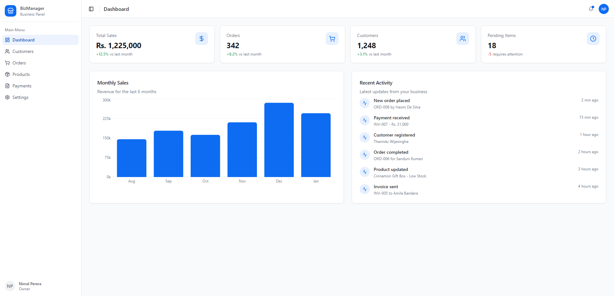

# Business Management System

A responsive business management dashboard developed as a personal frontend project using Next.js, React, TypeScript, and Tailwind CSS.

## Live Demo

[View Live Application](https://business-management-system-eight.vercel.app/)

## Dashboard Preview



## Overview

This project explores the development of a modern administrative interface for organizing and displaying business information.

The goal is to create a clean, responsive, and user-friendly dashboard for managing different aspects of a business.

## Project Features

- Dashboard interface for business information
- UI sections for clients and orders
- Product management interface
- Reports and data presentation
- Responsive layouts for different screen sizes

## Tech Stack

- **Next.js** - React framework
- **React** - Component-based user interfaces
- **TypeScript** - Type-safe JavaScript development
- **Tailwind CSS** - Responsive styling and layouts

## Getting Started

### 1. Clone the repository

```bash
git clone https://github.com/Dasan-Chamika/business-management-system.git
```

### 2. Navigate to the project directory

```bash
cd business-management-system
```

### 3. Install dependencies

```bash
npm install
```

### 4. Start the development server

```bash
npm run dev
```

### 5. Open the application

Visit http://localhost:3000 in your browser.

## Project Type

**Personal Portfolio Project**

Developed to demonstrate frontend development skills, reusable UI components, responsive dashboard layouts, and modern web application development.

## Developer

**Dasan Chamika**

Frontend & Web Developer

[GitHub Profile](https://github.com/Dasan-Chamika) | [LinkedIn](https://www.linkedin.com/in/dasan-chamika/)
